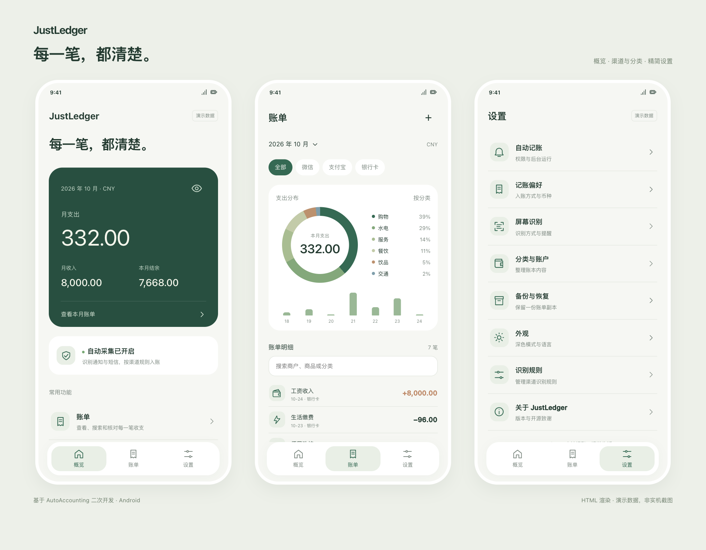
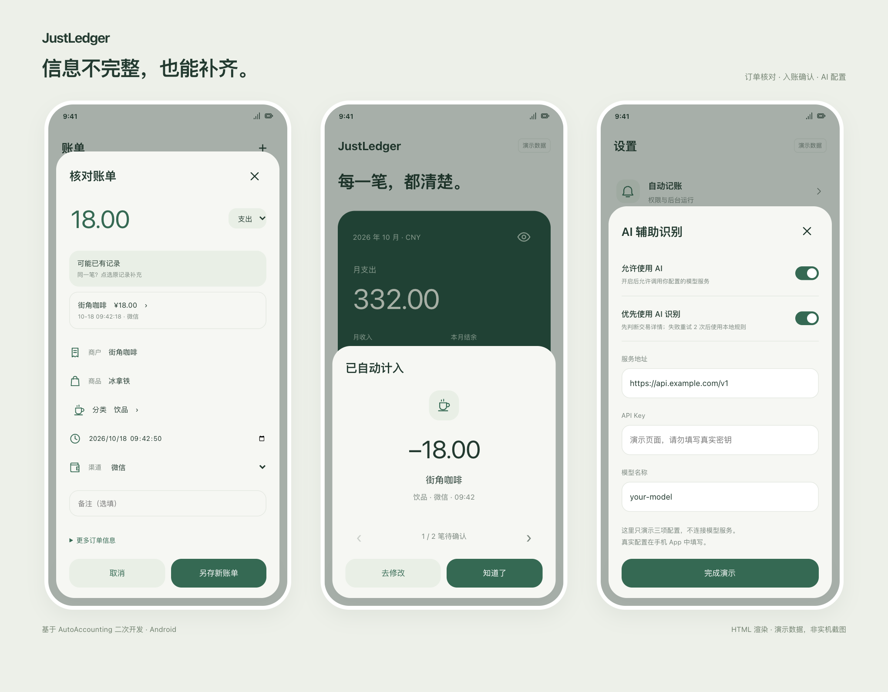

# JustLedger

**基于 [AutoAccounting](https://github.com/AutoAccountingOrg/AutoAccounting) 二次开发的 Android 自动记账本。** 保留付款采集与识别，重新设计界面，使用独立本地账本；不提供 AI 消费建议或财务分析。

[下载安装](https://github.com/ray204/JustLedger/releases) · [交互预览](https://ray204.github.io/JustLedger/design/preview.html) · [上游项目](https://github.com/AutoAccountingOrg/AutoAccounting) · [GPL-3.0](LICENSE)

## 界面预览

暖白与森林绿、圆角卡片、分类图标与简洁账单行，支持深色模式。





以上图片由仓库内 [HTML 交互预览](design/preview.html) 渲染，使用虚构演示数据，**不是手机截图**。界面和交互以实际 APK 为准。

## 功能介绍

- **付款采集**：通过 Android 通知、短信及屏幕 OCR 获取交易信息。各来源需要相应权限和匹配规则；不直连微信、支付宝或银行账户。
- **独立账本**：本地保存，按月份、分类和渠道查看；饼图展示分类占比，柱状图展示消费趋势。
- **删除保护**：长按账单先确认，取消或返回保留记录，旧版关闭确认的设置也不会绕过。
- **完整编辑**：修改金额、收支类型、分类、商户、商品、渠道、时间和备注，额外订单信息可展开查看。
- **AI 识别可选**：配置后优先判断整页是否为真实交易凭证，再提取信息和分类。明确判定非交易时停止；调用或解析失败最多重试两次，仍失败或未配置时使用本地规则。
- **补全与去重**：可信订单号、平台交易号及精确时间与内容等组合键匹配原账单，补齐缺失信息；金额相同本身不构成唯一键。模糊匹配显示候选，由用户确认关联。
- **入账确认**：自动入账后展示确认弹窗，多笔可左右切换；可进入编辑。已识别订单再次自动触发时静默处理，手动识别仍可查看和补充。
- **页面偏好**：识别成功后选择“记住”“暂时不”或“永不记住”；可在设置中移除偏好。记住的是页面类型，不是某一笔账单。

当前通知规则覆盖部分微信、支付宝和美团付款通知格式；银行短信和退款取决于具体格式与规则。不同应用版本、通知开关和系统后台限制可能影响采集，不能保证每笔交易均自动记录。

## 快速安装

1. 从 [Releases](https://github.com/ray204/JustLedger/releases) 下载 arm64 APK，在手机允许安装该来源后打开安装。
2. 打开 App，根据使用方式授予通知读取、通知显示及悬浮窗权限；屏幕识别需要启用 JustLedger 无障碍服务。
3. 在系统后台设置中允许必要的自启动和后台运行，然后配置下面的采集方式。

支持 Android 10 及以上；无障碍截图需要 Android 11 及以上，推荐 Android 11+ 的 arm64 真机。

本次发布为预览版：使用 Release 构建，但仍使用开发签名。应用 ID 保留 `net.ankio.auto`，与上游相同。若已装上游且签名不同，无法共存或直接覆盖，**请先备份再处理冲突**；同签名 JustLedger 更新可覆盖安装保留数据。APK 内部版本暂沿用 `4.0.2`，仓库发布版本独立编号。

### 付款通知记账

首次安装不会自动导入所有渠道规则。仓库提供本地通知规则，可通过电脑安装；不需要激活码。打开 App、连接开启 USB 调试的手机，在项目根目录执行：

```sh
adb forward tcp:52046 tcp:52045
python3 scripts/install-payment-rules.py
adb forward --remove tcp:52046
```

脚本仅添加缺失的微信、支付宝、美团本地付款通知规则，保留已有同名规则和自定义内容。随后在手机检查规则已启用、相应应用允许发送付款通知。交易没有发出通知时，可使用订单详情页 OCR 补充。

### 屏幕识别与 AI 配置

1. 开启屏幕识别和轻敲背面识别，在已付款订单或支付凭证页面主动触发识别。
2. 需要 AI 时，在“AI 辅助识别”填写 **服务地址、API Key、模型名称**，开启使用 AI 与优先 AI 识别。支持兼容 OpenAI Chat Completions 的接口；服务地址示例为 `https://api.example.com/v1`。
3. AI 根据整个页面及可访问的界面上下文判断是否为交易；聊天引用、商品广告、待付款及不确定内容应拒绝。模型仍可能出错，核对结果后再确认。
4. 核对分类和订单信息；疑似重复时选择原记录，或确认另存。首次成功识别可选择是否记住此类页面。

AI 开启后，OCR 文字及有限的页面上下文会发送到你配置的模型服务，按该服务计费；未配置时采用本地识别。图片转文字在手机执行，当前识别流程不上传屏幕图片。密钥只在手机填写，仓库和演示页不包含真实密钥。

## 数据与备份

账单、分类、规则和设置保存在 Android 应用私有目录的本地数据库及偏好设置中。当前版本没有自建云同步，不需要登录第三方记账本。卸载或清除应用数据会移除本地数据，请先在 App 内备份；备份文件和识别原文可能含隐私，不要公开上传。

## 开发与验证

需要 JDK 21、Android SDK 36；使用 Android Studio 打开仓库，或执行：

```sh
./gradlew :server:testDebugUnitTest :app:assembleDebug
./gradlew :app:assembleRelease
```

Release 默认使用本机开发签名；正式分发维护者应自行管理稳定签名，勿提交私钥。切换证书会影响覆盖升级。

- `app/`：Android 界面、采集、OCR、确认弹窗。
- `server/`：手机内本地服务、数据库、识别、去重与 AI 接口。
- `rules/`、`scripts/`：本地规则与辅助工具。
- `design/`、`docs/`：交互预览、文档及 HTML 渲染图片。
- `tests/device/`：真机集成验证。测试可能暂时改配置或创建测试数据，请在专用测试设备上运行。

[开发环境](docs/local-android-environment.md) · [整页识别与页面偏好](docs/page-recognition.md) · [重复订单与编辑循环](docs/ocr-trigger-loop-fix.md) · [预览图片生成](design/README.md)

## 上游与许可证

上游：[AutoAccountingOrg/AutoAccounting](https://github.com/AutoAccountingOrg/AutoAccounting)，本项目保留上游版权信息，遵循 [GPL-3.0](LICENSE)。
